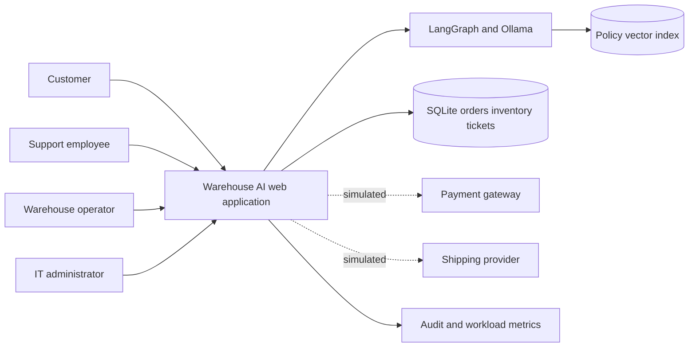
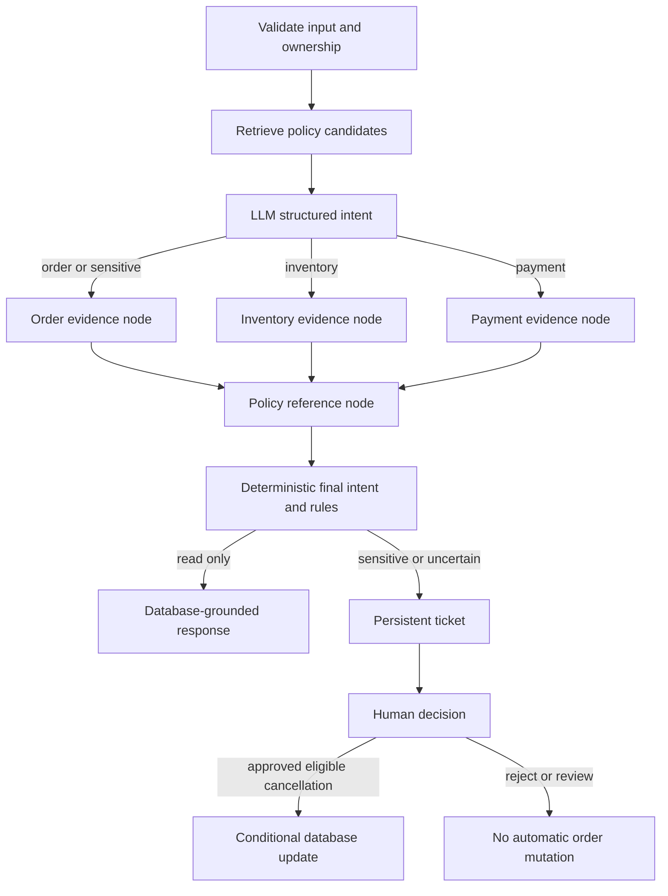

# Warehouse AI — Group 6 release candidate

## Install (existing project)
Stop app.py, commit current work, export old traces, and copy the contents of this package into the project root, replacing matching files. Keep .git and virtual environments. Use Python 3.12. Add `.venv-ai/`, `.venv/`, `.env`, `.env.*`, `!.env.example`, `*.db*`, `__pycache__/`, `benchmark-results.csv`, `execution-traces*.json` to .gitignore. Never commit API tokens, passwords or runtime data.

```sh
source .venv-ai/bin/activate
python -m pip install -r requirements.txt
WAREHOUSE_AI=0 python test_engine.py
python test_release.py
WAREHOUSE_AI=1 python app.py
```
Open http://127.0.0.1:8000. If FAISS installation fails, install `langgraph>=1,<2` alone; the pure-Python vector cosine fallback is functional but explicitly labeled in traces. Use `ollama list` and `curl http://127.0.0.1:11434/api/tags` to check your local AI. Model and URL are configurable. No extra model downloads are necessary. The policy index uses TF-IDF, not neural semantic embeddings. Retrieved documents are supplied to the LLM for structured intent generation; final business responses remain deterministic and policy-grounded, not unrestricted LLM prose.

## Demo in 3–4 minutes
1. Export old logs, reset demo. Customer cust_402, order ORD-99182. Ask status. Observe the LLM classifier trace and Vector retrieval (FAISS or Python fallback).
2. Ask: “I changed my mind about buying these headphones. I don't need them anymore.” Expected CANCEL, P01 policy, $89.99 simulated refund. If model fails, record it and try explicit “I want to cancel my order.” Don't claim indirect success if it returns REVIEW.
3. Open support desk, expand evidence. Warehouse: attempt fulfillment before approval (blocked); approve the cancellation, confirm CANCELLED. Ask status again. Failed payment ORD-4092 must also be blocked.
4. Run Autoscaling lab 50 → 500 → 50. Each batch performs actual transactional reservations in a disposable SQLite database with 12 units. Show 1 → 10 → 1 allocated workers, 12 reservations, 488 stock denials in 500 attempts, zero oversell. This is a batch scaling experiment, not real-time autoscaling or actual purchases. No changes to demo inventory.
5. Show observability trace and security results. Export traces. Record a backup video.

## Teammates without Ollama
Clone the feature branch after it is pushed. In project folder create a Python virtual environment; use Python 3.12 if available. Run `python test_engine.py` with WAREHOUSE_AI unset or 0, `python test_release.py`, and `WAREHOUSE_AI=0 python app.py` (Windows PowerShell: `$env:WAREHOUSE_AI='0'; python app.py`). No AI model required. Rule mode uses standard library; extra tests can use the Python vector fallback. For live AI install requirements and use an approved Ollama endpoint. Each local run has independent fictional data.

## Benchmark
In a second activated terminal run `python benchmark.py --ai` (requires working Ollama and LangGraph). It compares 7 identical cases across rule and AI modes on a disposable DB. CSV contains expected and actual final intents, latency, model status and token counts. Treat fallback as failed inference, even if final intent matches. Without Ollama run `python benchmark.py`. Run 50/500/50 scaling in UI and record actual numbers. For equal duration demand intervals, a fixed 10-worker allocation uses 30 worker-intervals and elastic 1+10+1 uses 12, a 60% reduction in modeled allocated capacity, NOT measured AWS cost. SQLite serialization can reduce scaling gains; report results honestly. Measure employee active work and full cancellation elapsed time using the same scenario for manual and assisted trials (repeat at least 3 times, report medians). Savings = (manual - assisted)/manual. Keep original 30% cost, 40% labor and 2-minute targets separate from measurements. Existing Part IV 1.5s P95 target is not proven.

## Hosting on another student's server (owner approval required)
This is a trusted-team demo only, not a public production app. All authenticated users can act as any simulated role and reset fictional data. Do not enter actual customer data. Server owner must provide a protected HTTPS reverse proxy with access/rate limits; no public Ollama or database port. Confirm the platform, private repository access, Ollama-compatible `/api/chat` endpoint reachable from the container, approved model name and resource limits. If AI service is OpenAI-compatible only, an adapter is needed. Do not start another Ollama container without owner approval.

The included Dockerfile runs as a non-root user. Compose binds to loopback port 18080; owner must select unused port and route HTTPS to it. If reverse proxy is in another container, owner must adapt private networking rather than opening the app publicly. Existing Ollama service must be reachable through an approved network/URL; `ollama` is only an example name and no Ollama service is started by this compose file. Set `.env` on the server, never in Git: unique password 12+ chars, actual HTTPS origin (scheme + domain, no path), model, Ollama URL, optional API bearer token. For a protected rule-mode demo set WAREHOUSE_AI=0. Server owner can adapt the configuration to their hosting dashboard. With Docker Compose CLI on the host:

```sh
cp .env.example .env
# Edit .env privately, confirm proxy and network with owner first.
docker compose config --quiet
docker compose up -d --build
docker compose ps
docker compose logs --tail=50 warehouse
```
Persistent named volume mounted at /data; do not use `docker compose down -v`. Verify HTTPS login, unauthorized API returns 401, live inference trace, cancellation, reset, and restart persistence. Use prior Git commit/image to roll back after stopping new deployment; DB changes are additive, back up volume first. Stop the demo when not needed. Docker/FAISS/live model must be verified on target; not executed in authoring environment.

## Rubric mapping
- 16 points pitch: problem, context diagram, under 2 minutes, 30% modeled cost goal, unpaid fulfillment guard.
- 16 architecture: diagram below, typed state, conditional edges, vector policies, read-only AI input, deterministic permission boundary, validation/ownership and basic redaction. Shared login is not RBAC.
- 16 final demo: actual order DB and persistent human approval replace Colab's hardcoded data and auto-approval. Graph performs classification/retrieval; human ticket persistence remains outside graph.
- 16 validation: original six tests + new tests, benchmark output, logs, security events, maintain weekly labeled golden tests and document drift, test adapter compatibility, redact and restrict access, stop/rollback on unsafe behavior or severe latency/errors.
- 16 communication: 12–15 minute slides including 3–4 minute demo, 3–5 minute Q&A; all members participate.
- 20 learning outcomes: explicitly connect architecture to intelligent principles, business efficiency, adaptive prototype, metrics/governance and enterprise integration.




## Known limitations
Not production-ready: shared demo login, no per-user RBAC, basic pattern guard and partial PII redaction, no real refunds/shipping, no AWS deployment, batch scaling rather than continuously elastic infrastructure, no neural embeddings, no real uptime/financial savings measurements. Use fictional data only. Hosting requires owner approval and remote testing. Automated tests use a mocked model for arbitration; live model accuracy is measured separately.
